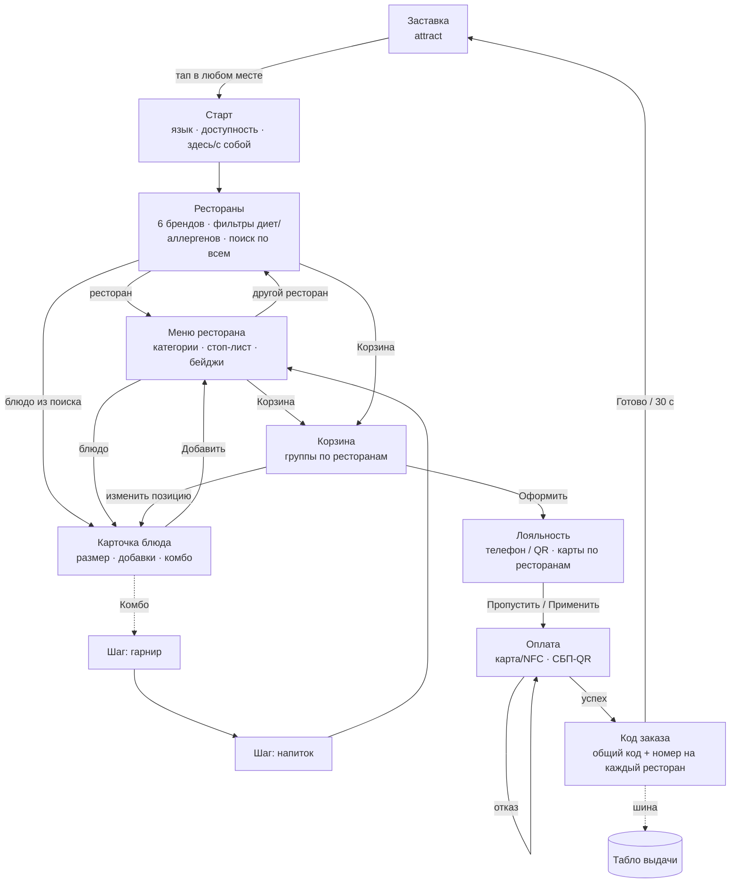
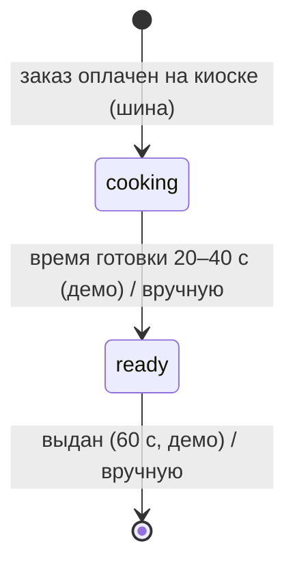
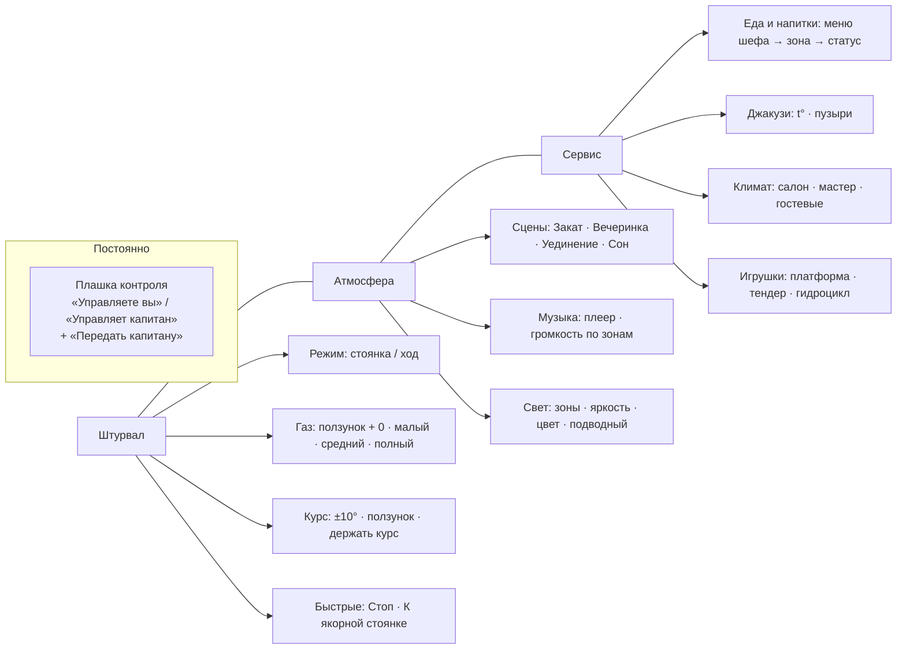
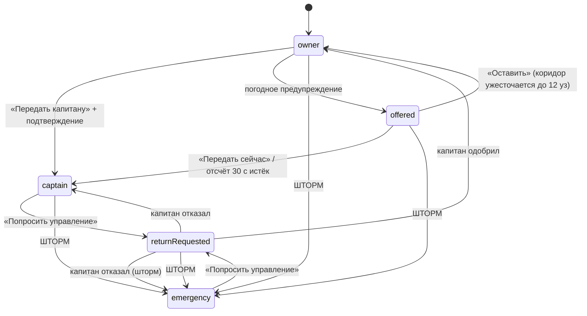

# Логика и флоу: 4 прототипа

Два продукта × две дизайн-системы. **Флоу и логика у пары M3/HIG общие** и живут в `packages/*-core`. Приложения в `apps/*` отличаются только системными паттернами (таблицы «M3 ↔ HIG» ниже). Визуал на этом этапе не прорабатывается.

| | M3 Expressive (Framework7 `md`) | Apple HIG (Ionic React, iOS mode) |
|---|---|---|
| Киоск фудкорта, 1080×1920 | `apps/kiosk-m3` | `apps/kiosk-hig` |
| Пульт яхты, телефон | `apps/yacht-m3` | `apps/yacht-hig` |

---

## 1. Киоск фудкорта

### 1.1 Карта экранов

Шаги в ядре: `attract → start → restaurants → menu → cart → loyalty → payment → done` (`STEP_ORDER`, `guardStep` в [logic.ts](../packages/kiosk-core/src/logic.ts)). Карточка блюда открывается поверх меню, это не отдельный шаг.

### 1.2 Правила по шагам

**Заставка.** Крутит бренды фудкорта. Тап в любом месте начинает сессию. Кнопки языка и доступности видны уже здесь, чтобы гость мог переключить их до начала.

**Старт.** Три вопроса на одном экране:
- язык RU/EN;
- «Доступность»: нижний режим, крупный текст, контраст;
- «Здесь / С собой». Выбор режима сразу ведёт к ресторанам.

**Рестораны.**
- Сетка из шести брендов. На каждой карточке: цвет, монограмма, кухня, бейдж «есть программа лояльности».
- Сквозной фильтр: исключить аллергены (глютен, молоко, орехи, яйцо, рыба, соя, кунжут), требовать теги (веган, вегетарианское, острое, халяль). Фильтр сохраняется при переходе в меню. На карточке ресторана показывается число подходящих блюд (`matchingCount`); ресторан без подходящих блюд приглушён, но остаётся доступен.
- Поиск по всем меню сразу, на обоих языках.

**Меню ресторана.**
- Шапка в цветах бренда, вкладки категорий.
- Блюда из стоп-листа видны, но недоступны, с подписью «Закончилось». Так гость понимает, что блюдо в меню есть, а сейчас его нет.
- У каждого блюда пиктограммы аллергенов и диет **с текстовой подписью**: одна пиктограмма без подписи считается недоступной.

**Карточка блюда.**
- Обязательные группы (размер, острота, основа) приходят с предвыбором по умолчанию. Если обязательная группа пустая, кнопка «Добавить» неактивна и указывает на группу (`validateLine`).
- В группах добавок стоит лимит. Когда лимит набран, остальные опции блокируются, и гость видит подпись «до 2».
- Аллергены пересчитываются от выбора: миндальное молоко добавляет «орехи» (`lineAllergens`).
- Комбо — переключатель «Сделать комбо +220 ₽», за ним два шага (гарнир, напиток), у каждого шага своя доплата.
- Цена считается вживую (`unitPrice`), количество задаётся степпером.
- Одинаковые конфигурации в корзине сливаются в одну строку.

**Корзина** (кнопка корзины со счётчиком видна на всех экранах выбора).
- Позиции сгруппированы по ресторанам в порядке добавления, у каждой группы свой подытог.
- Позицию можно открыть для изменения (та же карточка блюда, `replaceLine`), поменять количество или удалить.
- Если удалить последнюю позицию на шаге оформления, гость возвращается к ресторанам.

**Лояльность.** Шаг необязательный, «Пропустить» видна всегда.
- Вход по телефону (своя цифровая клавиатура, без системной) или по QR из приложения. Демо: `+7 900 000-00-00` или QR `TIB-GUEST-1`.
- Показываются **только рестораны из корзины**:

| Программа | Ресторан | Механика | Когда нельзя |
|---|---|---|---|
| Баллы | Дым и Булка | списать до min(баланс, 50% подытога); начисление 5% от оплаченного | баланс 0 |
| Скидка участника | Сансё | −10% на подытог ресторана | — |
| Штампы | Зерно | 6 штампов → самый дешёвый кофе в корзине бесплатно; за подарочный кофе штамп не начисляется | < 6 штампов; нет кофе в корзине (подсказка «добавьте кофе») |
| нет программы | Корка, Лаваш Лаб, Листва | блок не показывается | — |

- Если у гостя нет карты в ресторане с программой, показывается подсказка «Нет карты» без регистрации на кассе (не задерживаем очередь).
- Кнопку «Выйти из профиля» видно всё время: сессия публичная.

**Оплата.**
- Способы: карта/NFC или СБП-QR. Состояния: `waiting → processing → success | declined`.
- При отказе корзина не теряется, гость может повторить или выбрать другой способ.
- Во время `processing` отмена и таймер простоя заблокированы.

**Код заказа.**
- Крупно общий код фудкорта, например **А-47**. Буквы взяты из набора, одинаково выглядящего в кириллице и латинице (`orderCode`), поэтому код читают и турист, и сотрудник.
- Под кодом — **номер выдачи на каждый ресторан в паре с брендом**: «Дым и Булка · 100», «Сансё · 100».
- «Чек в SMS» / «Распечатать».
- Подсказка «Следите за табло». Через 30 с или по «Готово» — возврат на заставку.

### 1.3 Повторяющиеся номера выдачи
У каждого ресторана своя нумерация (`TicketScheme`). Номера разных ресторанов **совпадают специально**: у «Дым и Булка» и «Сансё» номера 100–199, у «Корка» и «Листва» 1–99. Правила:
1. Номер нигде не показывается без бренда: ни на экране кода, ни на табло, ни в чеке.
2. Ключ записи на табло — `код заказа + ресторан`, а не номер.
3. Общий код заказа связывает все номера одного гостя, его же проверяет сотрудник при выдаче.

### 1.4 Сквозные правила
- **Простой.** 60 с без касаний → диалог «Вы ещё здесь?» с отсчётом 20 с → сброс сессии (`createIdleTimer`). На заставке, на экране кода и во время оплаты таймер не работает.
- **Отмена заказа.** Доступна на шагах `start…loyalty` (`CANCELLABLE`), требует подтверждения. Сбрасывает сессию.
- **Доступность.** Панель открывается с любого экрана, настройки живут до конца сессии:
  - *Нижний режим.* Весь интерактив уходит в нижние ~960 px экрана 1920 px: до него дотянется человек в коляске или ребёнок. Сверху остаётся только неинтерактивная шапка.
  - *Крупный текст* (×1.3) и *высокий контраст*.
  - *RU/EN* переключаются мгновенно и без потери корзины. Все тексты в данных хранятся парами `LText`.
  - Пиктограммы аллергенов и диет всегда с подписью. Цели касания крупнее системного минимума (48 dp / 44 pt). Корректные ARIA-роли и метки, работает фокус с клавиатуры.
- **Сброс сессии** обнуляет корзину, гостя и настройки доступности: следующий гость может быть другим человеком. Счётчики номеров и кодов живут на уровне киоска и не сбрасываются.

### 1.5 Табло выдачи (`/board`)

- Две колонки: «Готовится» и «Готово». Карточка = логотип-монограмма в цвете бренда + номер. Первые 10 с готовая карточка подсвечена (`isFresh`).
- Киоск и табло — разные вкладки, связаны через `BroadcastChannel` (`kioskBus`), бэкенд не нужен.

### 1.6 M3 ↔ HIG: киоск

| Задача | M3 Expressive (Framework7) | Apple HIG (Ionic, по iPadOS) |
|---|---|---|
| Выбор ресторана | Сетка Cards | Сетка/инсет-список, крупные ячейки |
| Категории меню | Tabs / Chips | Segmented control |
| Фильтры диет/аллергенов | Filter chips | Список с переключателями в Sheet («Фильтры») |
| Корзина всегда под рукой | Extended FAB со счётчиком | Toolbar с кнопкой корзины и итогом |
| Карточка блюда | Fullscreen dialog / Bottom sheet | Sheet (page sheet) |
| Модификаторы | List: radio / checkbox | Inset grouped List с галочками |
| Количество | Stepper | Stepper |
| Шаги комбо | Внутри sheet, кнопки «Далее / Назад» | Навигация внутри sheet (push) |
| Лояльность, ввод телефона | Bottom sheet + клавиатура из кнопок | Sheet + клавиатура из кнопок |
| Подтверждение отмены, «Вы ещё здесь?» | Dialog | Alert |
| «Добавлено в корзину» | Snackbar (Toast) | Toast/Notification сверху |
| Панель доступности | Side sheet (Panel) | Popover / Sheet |

---

## 2. Пульт яхты

### 2.1 Структура

Пульт рассчитан на удовольствие владельца, а не на работу экипажа. Технической «внутрянки» (винты, энергетика) в нём нет. Скорость, курс, ветер и волна — единственная телеметрия, и показаны они ради впечатления.

### 2.2 Безопасный коридор
Владелец управляет по-настоящему, но **внутри коридора**. Ядро берёт самое строгое из ограничений (`computeLimits`):

| Источник | Лимит скорости | Причина в UI |
|---|---|---|
| Открытое море | 28 уз (полный ход) | — |
| Прибрежная зона | 14 уз | «Скорость ограничена: прибрежная зона» |
| Гавань | 6 уз | «…рядом гавань» |
| Погодное предупреждение / владелец отказался передать | 12 уз | «…из-за погоды» |
| На якоре | 0 | «Яхта на якоре» |
| Управляет капитан | 0 для команд владельца | «Сейчас управляет капитан» |

- Команда сверх лимита **не отклоняется, а зажимается** до лимита. Владелец видит неблокирующее уведомление с причиной (`requestSpeed`).
- Если коридор сузился на ходу (вошли в гавань, началась непогода), цель снижается сама и яхта плавно тормозит.
- Разгон 1,5 уз/с, торможение 3 уз/с. Поворот по кратчайшей дуге, скорость поворота ограничена (`stepHelm`).
- Встать на якорь можно только после остановки. Если яхта на ходу, команда сначала сбрасывает ход.
- «К якорной стоянке» — автопилот: малый ход, курс на бухту, по прибытии яхта встаёт на якорь. Любая ручная команда хода отменяет автопилот.

### 2.3 Передача контроля капитану

(`controlReducer` в [logic.ts](../packages/yacht-core/src/logic.ts))

Три сценария:
1. **Сам владелец.** Кнопка в плашке контроля с любого экрана, одно подтверждение.
2. **Предупреждение о погоде.** Модальное предложение «Капитан рекомендует передать управление» с отсчётом 30 с. По истечении отсчёта управление передаётся автоматически. Если владелец выбрал «Оставить», коридор ужесточается до 12 уз, пока погода не наладится.
3. **Шторм или авария.** Передача **мгновенная, без подтверждения, из любого состояния**. Полноэкранный критический алерт с причиной и тем, что делает капитан. Одновременно:
   - штурвал переходит в режим «только просмотр»;
   - игрушки и платформа убираются;
   - джакузи уходит в безопасный режим: пузыри выключены, включить их нельзя;
   - капитан ставит безопасный ход 8 уз.

   Свет, музыка, климат и заказ еды остаются доступны: гостю важно чувствовать, что на борту всё под контролем.

Вернуть управление может **только капитан**. Владелец лишь просит, его собственные события не возвращают контроль. Когда управляет капитан, штурвал виден только на чтение, сверху подпись «Управляет капитан».

### 2.4 Атмосфера
- **Сцены одним касанием** (`scenes` в [data.ts](../packages/yacht-core/src/data.ts)) сразу задают свет по зонам, музыку (настроение + громкость), джакузи и ход.
  - Ходовую часть сцена применяет **только если владелец у руля и яхта не на якоре**. Комфорт применяется всегда.
  - «Уединение» ход не трогает.
  - Ручная правка света или громкости снимает отметку активной сцены.
- **Музыка.** Play/pause, переключение треков. Громкость отдельно для палубы, салона и кают.
- **Свет.** Зоны «палуба», «салон», «каюты», «подводная подсветка»; у каждой вкл/выкл, яркость и цвет.

### 2.5 Сервис
- **Еда и напитки.** Меню шефа → количество → зона доставки (солнечная палуба, джакузи, салон, нос, мастер-каюта) → комментарий → статусы `принято → готовится → несут → доставлено`. Активный заказ виден компактно на всех экранах.
- **Джакузи.** Целевая температура 30–40 °C, текущая к ней плавно тянется. Пузыри.
- **Климат.** Салон, мастер-каюта, гостевые: 16–28 °C.
- **Игрушки.** Кормовая платформа, тендер, гидроцикл; статусы `stowed → preparing → ready → stowing`. Спуск запрещён (`toyBlock`):
  - на ходу > 3 уз — подсказка «Остановите яхту или встаньте на якорь»;
  - при погодном предупреждении;
  - в шторм.

  Убрать игрушку можно всегда.

### 2.6 Демо-панель
Скрытая боковая панель, открывается долгим нажатием на название яхты. Через неё приходят события, которые в жизни шлют погода и капитан:
- погодное предупреждение, шторм, погода наладилась;
- капитан одобрил или отказал возврат управления;
- еда доставлена, игрушка готова;
- зона: открытое море / прибрежная / гавань;
- сброс.

### 2.7 M3 ↔ HIG: яхта

| Задача | M3 Expressive (Framework7) | Apple HIG (Ionic) |
|---|---|---|
| Три раздела | Navigation bar (Tabbar) | Tab bar |
| Плашка контроля | Top app bar + Assist chip / Extended FAB «Передать» | Large title navbar + кнопка в toolbar |
| Газ, курс, громкость, яркость, t° | Slider (Range) | Slider (Range) |
| Пресеты газа | Segmented buttons | Segmented control |
| Скорость/курс | Gauge | Gauge |
| Сцены | Cards (крупные, Expressive shapes) | Cards / grouped List |
| Режимы вкл/выкл | Switch | Toggle |
| Подтверждение передачи | Dialog | Action sheet (destructive-стиль) |
| Погодное предложение | Dialog с таймером | Alert с таймером |
| Шторм | Fullscreen dialog | Full-screen modal (Popup) |
| Ограничение коридора | Snackbar | Banner/Toast сверху |
| Заказ еды | Bottom sheet, List + Stepper | Sheet, inset List + Stepper |
| Демо-панель | Navigation drawer (Panel) | Panel |

---

## 3. Что дальше (этап 2, после ревью)
Собрано. M3-версии сделаны на компонентах Framework7 (`md`) с токенами M3 Expressive. HIG-версии сделаны на Ionic React в iOS mode: Framework7 `ios` выглядел недостаточно по-эппловски. В Ionic нет системного степпера (UIStepper), поэтому количество задаётся парой системных кнопок −/+, а у пульта нет Gauge, и скорость с курсом показаны крупными цифрами в inset-группе. Фото блюд взяты из открытых коллекций под CC (см. `assets/ATTRIBUTION.md`).
